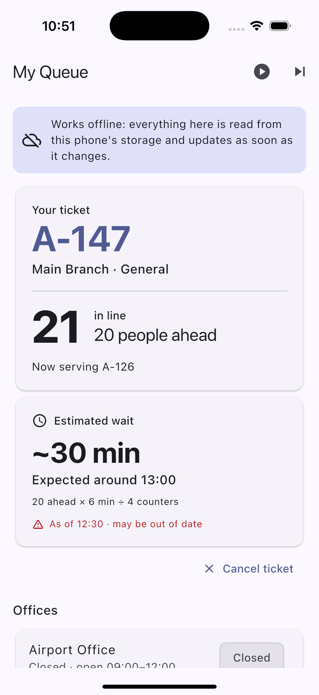

# Queue System — Local Data Model

The offline data layer for a queue (ticketing) app: how the user's **ticket**,
their **queue position** and each office's **status** are stored on the
phone, so the app keeps working with no internet connection.



## Contents

- [What's here](#whats-here)
- [Run it](#run-it)
- [Entities](#entities)
- [Database schema](#database-schema)
- [How it works offline](#how-it-works-offline)
- [Repository](#repository)
- [Sample data: 1000 rows](#sample-data-1000-rows)
- [Storage trade-offs](#storage-trade-offs)
- [Tests](#tests)
- [Fixes](#fixes)

## What's here

| Requirement | Where |
|---|---|
| Entity structure for Ticket and OfficeStatus | [`lib/features/queue/domain/entities/`](lib/features/queue/domain/entities/) |
| Local repository pattern | [`queue_repository.dart`](lib/features/queue/domain/queue_repository.dart) (interface), [`sqlite_queue_repository.dart`](lib/features/queue/data/sqlite_queue_repository.dart) (SQLite) |
| Script that generates 1000 rows of queue data | [`tool/generate_sample_data.dart`](tool/generate_sample_data.dart), output in [`sample_data/`](sample_data/) |
| Trade-offs of the storage library | [`docs/storage-tradeoffs.md`](docs/storage-tradeoffs.md) |

```
lib/
├── main.dart                         Opens the database, loads sample data on
│                                     first launch, shows the screen
├── core/database/queue_database.dart Schema, indexes, migrations
└── features/queue/
    ├── domain/                       Plain Dart, no Flutter or database code
    │   ├── entities/                 Ticket, OfficeStatus, QueuePosition, enums
    │   └── queue_repository.dart     The repository interface
    ├── data/
    │   ├── sqlite_queue_repository.dart
    │   ├── row_mappers.dart          Entity <-> database row
    │   └── sample_data_generator.dart
    └── presentation/
        └── queue_home_screen.dart    Ticket, position, offices (offline)
tool/generate_sample_data.dart        1000-row generator script
sample_data/                          Generated queue_sample.db and .json
docs/storage-tradeoffs.md
```

## Run it

Requires Flutter 3.35 (Dart 3.9).

```bash
flutter pub get
flutter run                                    # the app (iOS or Android)
flutter test                                   # 24 tests
dart run tool/generate_sample_data.dart        # regenerate sample_data/
```

On first launch the app fills its empty database with a day of sample data
(1000 tickets, 4 offices) and shows the user's ticket, place in line and every
office's status, all read from local storage. The app makes no network
calls.

## Entities

### `Ticket` — [ticket.dart](lib/features/queue/domain/entities/ticket.dart)

The user's own ticket, or another customer's ticket in the office's queue.

| Field | Type | Meaning |
|---|---|---|
| `id` | String | Unique id. Tickets created offline get a device-made id (`local-…`) so they never clash with server ids. |
| `officeId` | String | The office. |
| `serviceCode` | String | Service line, e.g. `A` general, `B` payments, `C` documents. |
| `number` | int? | Number in the day's line for that service. `null` while an offline ticket waits for the server to assign one. |
| `serviceDate` | String | `yyyy-MM-dd`. Numbers restart each day. |
| `status` | TicketStatus | `waiting`, `called`, `serving`, `completed`, `cancelled`, `noShow`. |
| `issuedAt`, `calledAt`, `completedAt` | DateTime | Life-cycle times. |
| `counter` | int? | Counter the ticket was called to. |
| `position` | int? | Place in line, 1 = next. Only set while waiting. |
| `positionUpdatedAt` | DateTime? | When `position` was last worked out. |
| `isMine` | bool | This device's user owns the ticket. |
| `syncState` | SyncState | `synced`, `pendingCreate` (made offline), `pendingCancel` (cancelled offline). |
| `updatedAt` | DateTime | Last change. |

`code` gives the label people see: `A-042`, or `A-…` before a number exists.

### `OfficeStatus` — [office_status.dart](lib/features/queue/domain/entities/office_status.dart)

The latest known state of an office.

| Field | Type | Meaning |
|---|---|---|
| `officeId`, `name` | String | |
| `isOpen` | bool | Serving customers now. |
| `opensAt`, `closesAt` | String | `HH:mm`. |
| `nowServing` | String? | Ticket code at the counter most recently, e.g. `A-126`. |
| `waitingCount` | int | Tickets waiting across all services. |
| `countersOpen` | int | Counters serving now. |
| `averageServiceMinutes` | int | Used for wait estimates. |
| `updatedAt` | DateTime | When the office produced this status. |
| `syncedAt` | DateTime | When this device saved it. |

### `QueuePosition` — [queue_position.dart](lib/features/queue/domain/entities/queue_position.dart)

Not stored; built by the repository from a ticket and its office.

| Member | Meaning |
|---|---|
| `position`, `peopleAhead` | Place in line and people in front. |
| `estimatedWait` | `peopleAhead × averageServiceMinutes ÷ countersOpen`, rounded up. |
| `asOf` | How fresh the position is: when it was worked out, or when the office's data was last synced (`syncedAt`), whichever is older. |
| `isStale(now)` | Older than 5 minutes: the app says "may be out of date". |

## Database schema

SQLite, version 1, defined in
[`queue_database.dart`](lib/core/database/queue_database.dart).

```
office_status (1) ───< tickets (many)
  office_id PK            id PK
  name                    office_id FK → office_status
  is_open                 service_code, number, service_date
  opens_at, closes_at     status, issued_at, called_at, completed_at, counter
  now_serving             position, position_updated_at
  waiting_count           is_mine, sync_state, updated_at
  counters_open
  average_service_minutes
  updated_at, synced_at
```

| Index / rule | Purpose |
|---|---|
| `idx_tickets_line (office_id, service_date, service_code, status, number)` | Line order and fast position counting. |
| `idx_tickets_number` unique `(office_id, service_date, service_code, number)` where number is set | A number is used once per line and day. |
| `idx_tickets_one_active_mine` unique `(office_id)` where mine and active | The user holds at most one active ticket per office. |
| `idx_tickets_mine`, `idx_tickets_pending` | Quick lookups of "my tickets" and unsynced changes. |
| CHECK on `status`, `sync_state`, `is_open`, `is_mine` | Only known values can be stored. |
| Foreign key `tickets.office_id` | Tickets always belong to a known office. |

To change the schema, raise `QueueDatabase.version` and add that version's
SQL steps; existing installs run only the new steps.

## How it works offline

- **Everything is read locally.** The screen and any business logic read
  through the repository from the phone's database; nothing needs a
  connection.
- **Queue position.** When ticket data arrives (sync, or the sample data),
  `recomputePositions` sets each waiting ticket's position: 1 + waiting
  tickets in the same office, day and service with a lower number.
  Finished tickets lose their position. The user's position is then a
  single-row read.
- **How fresh is it.** Every position keeps `positionUpdatedAt`, and every
  office status keeps `updatedAt` and `syncedAt`. A position recalculated
  on the phone is only as fresh as the data it was counted from, so "as of"
  is the older of `positionUpdatedAt` and the office's `syncedAt`. The app
  shows "as of 12:30" and warns when that is over 5 minutes old, instead of
  pretending it's live.
- **Actions while offline.**
  - *Take a ticket:* saved as `pendingCreate`, with no number (`A-…`) and an
    estimated position at the end of the line. The server assigns the real
    number later (`markSynced(id, assignedNumber: 42)`).
  - *Cancel:* a synced ticket becomes `cancelled` + `pendingCancel`, and
    everyone behind moves up. A ticket the server never saw is just deleted.
- **Sync outbox.** `getPendingChanges()` lists what to send when the
  connection returns; `markSynced()` clears each item. If the server's
  number is already used in that line, `markSynced()` throws a
  `QueueException` and leaves the ticket pending. A sync service
  (not part of this task) would call these, then save the server's latest
  tickets and office statuses.

## Repository

[`QueueRepository`](lib/features/queue/domain/queue_repository.dart) is the
only way the app reaches stored data; screens never see SQL. The screen test
swaps in a small fake repository with no database, which is the point of the
pattern.

| Method | Does |
|---|---|
| `getOffices()`, `getOfficeStatus(id)` | Read office status. |
| `saveOfficeStatuses(list)` | Insert or update statuses (e.g. after sync). |
| `saveTickets(list)` | Insert or update tickets in one transaction. Throws `QueueException` if a rule would break. |
| `getTicket(id)`, `getQueue(officeId, date, statuses:)` | Read tickets, in line order. |
| `getMyTickets(activeOnly:)` | The user's tickets, newest first. |
| `getMyPosition(ticketId)` | `QueuePosition` for a waiting ticket. |
| `recomputePositions(officeId, date, now:)` | Recalculate positions from local data. |
| `requestTicketOffline(...)`, `cancelMyTicket(...)` | Offline actions. |
| `getPendingChanges()`, `markSynced(id, assignedNumber:)` | Sync outbox. `markSynced` throws `QueueException` for an unknown ticket or a number already in use. |
| `countTickets()` | Row count. |

Implemented by
[`SqliteQueueRepository`](lib/features/queue/data/sqlite_queue_repository.dart).
It uses only `sqflite_common`, so the same code runs in the app (sqflite) and
in plain Dart (`sqflite_common_ffi`) for the script and tests.

## Sample data: 1000 rows

```bash
dart run tool/generate_sample_data.dart [--count 1000] [--seed 42] [--date 2026-11-21] [--out sample_data]
```

Generates one day of queue data as seen at 12:30 and writes:

- `sample_data/queue_sample.db` — a ready SQLite database (same schema as the
  app), written through the real repository.
- `sample_data/queue_sample.json` — the same rows as JSON.

The checked-in sample (seed 42):

```
Generated 1000 tickets for 4 offices (seed 42, 2026-11-21 12:30)
  waiting: 201, called: 7, serving: 9, completed: 701, cancelled: 42, no_show: 40
  offices: Airport Office (closed, 0 waiting); City Centre (open, 71 waiting);
           Main Branch (open, 84 waiting); North Branch (open, 46 waiting)
  my ticket: A-147 at Main Branch, position 21, 20 ahead, ~30 min
```

The data is realistic and self-consistent: tickets issued from 09:00, earlier
tickets finished, one serving and maybe one called per line, the newest
waiting, a closed office with everyone served, and exactly one active ticket
belonging to the user. The same seed always produces the same data. Checks
run on the generated file found no gaps in any line's positions, no finished
ticket with a position, no duplicate numbers, and office waiting counts that
match the tickets.

From code, `generateSampleQueueData(now: ...)` accepts any time after 09:00
(opening time) and never creates a ticket issued after `now`. An earlier
time throws an `ArgumentError`.

## Storage trade-offs

The app uses SQLite through **sqflite**. The full comparison with drift,
Hive, Isar and shared_preferences, and the costs of this choice, is in
[`docs/storage-tradeoffs.md`](docs/storage-tradeoffs.md). In short:

- **Why:** queue position is a fast indexed count; the database enforces the
  queue rules (one active ticket per office, unique numbers, valid statuses);
  transactions; simple versioned migrations; the same code runs in the app,
  the generator and the tests.
- **Costs:** hand-written SQL and mapping; no built-in live UI updates; old
  SQLite on Android 7–10 (no upsert or window functions, so neither is used);
  no web support; dates stored as text.

## Tests

`flutter test` runs 24 tests:

| File | Covers |
|---|---|
| `entities_test.dart` | Ticket codes, statuses, wait estimate, staleness |
| `sqlite_queue_repository_test.dart` | Office upsert, line order, positions, my position and how fresh it is, one active ticket per office, unique numbers, offline ticket and sync (including a clashing number), cancel, data kept after reopening |
| `sample_data_generator_test.dart` | Exactly 1000 rows, same seed = same data, any time after opening with no future tickets, loaded data is consistent |
| `queue_home_screen_test.dart` | Screen shows ticket, position, wait, offices and the out-of-date warning (fake repository) |

## Fixes

Found while checking the first version; each now has a test.

| Problem | Fix |
|---|---|
| **Old data shown as current.** Recalculating positions on the phone stamped them with the current time. A ticket taken offline at 15:00 from data synced at 10:00 showed "As of 15:00" with no warning. | `getMyPosition` uses the older of the recalculation time and the office's `syncedAt`, so it now shows "As of 10:00 · may be out of date". |
| **Raw database error on sync.** `markSynced` with a number already used in the line threw a SQLite exception. | It throws a `QueueException`, like `saveTickets`, and the ticket stays pending. |
| **Generator crash before opening.** `generateSampleQueueData` with a time at or before 09:00 crashed (`RangeError`), and before 11:30 the closed office got tickets issued after `now`. | Times at or before 09:00 throw a clear `ArgumentError`; no ticket is issued after `now`. The script itself always uses 12:30. |
